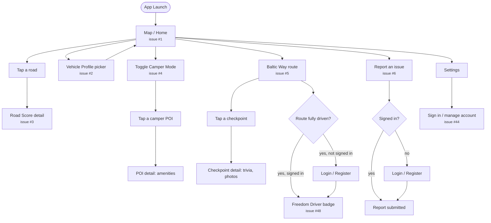
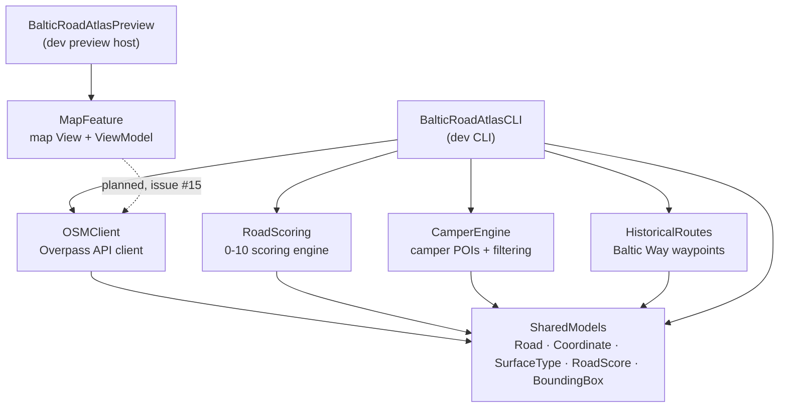
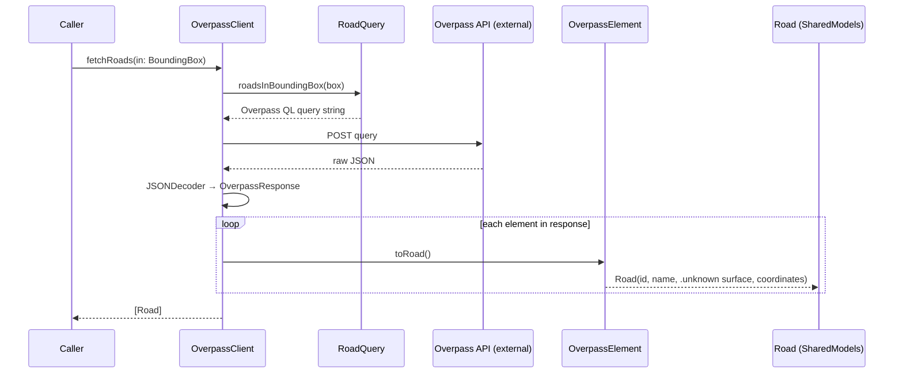

# Baltic Road Atlas

An iOS-first road intelligence app for the Baltic countries — 🇱🇻 Latvia, 🇱🇹 Lithuania, 🇪🇪 Estonia.

Baltic Road Atlas doesn't compete with Google Maps or Apple Maps as a turn-by-turn
navigator. It's the layer you check _before_ or _during_ a trip to answer the
question those apps don't: **is this road worth driving?**

Is it asphalt or gravel? In good condition? Fine for a camper? Where can I park
overnight, refill water, find a toilet, or see something interesting along the way?

## Who it's for

- **Primary:** camper owners, vanlifers, motorcyclists, road-trip travelers
- **Secondary:** everyday drivers, tourists, caravan owners, cyclists

## Core features

- **Road Quality Score** — every road gets a 0–10 score derived from OSM surface/smoothness
  tags, community reports, and (eventually) sensor-based vibration data.
- **Road Surface Layer** — map roads colored by surface: asphalt, concrete, gravel, dirt,
  sand, cobblestone.
- **Camper Mode** — overnight parking, campsites, toilets, showers, water, waste disposal,
  electricity; routing that eventually avoids dirt roads, low bridges, weight/width limits.
- **Community Reports** — potholes, construction, flooding, closures, gravel sections,
  hazards; reports expire unless confirmed by others.
- **Baltic Way Route** — a historical drive along the 1989 Baltic Way, with monuments,
  memorials, photos, and (future) audio guides.
- **Scenic Routes** — community-rated coastal drives, forest roads, motorcycle routes,
  camper-friendly roads, hidden gems.
- **Offline Mode** — download Latvia, Lithuania, and Estonia for offline use.

See [CLAUDE.md](../CLAUDE.md) for architecture, conventions, and current build status.

## User flow (planned)

**Status check first:** right now only the bare map screen exists in code (no real
road data on it yet — that's issue #15). Everything below is the *target* flow the
GitHub issues are already scoped against, not something built yet. Treat this as the
map for where each issue slots in, not a description of current behavior.

Design decision this flow encodes: **no login wall.** The app opens straight to the
map and is fully usable with zero account — browsing roads, scores, and camper info
needs nothing. Login/Register only interrupts the flow at the two moments an account
is actually required: submitting a community report, and syncing progress/profiles
across devices. This matches how auth is already scoped in the issue tracker (Phase 2,
tied to Community Reports + Supabase) rather than being a separate, earlier gate.



`Login / Register` itself isn't a dead end on this diagram — it's a modal/sheet that
appears in front of whatever the user was doing, then returns them to it. Note also
that `Settings` doesn't have a dedicated GitHub issue yet (it was in the original
folder-structure sketch but never broken out) — worth creating one whenever it's
actually next in line.

## Data sources

- **OpenStreetMap** (via the Overpass API) — roads, surface types, smoothness, parking,
  campsites, toilets, water points, fuel stations.
- **Community reports** — user-submitted, becomes a proprietary dataset over time.
- **Government open data** (future) — roadworks, closures, maintenance.

## Tech stack

| Layer           | Choice                                              |
| --------------- | --------------------------------------------------- |
| Platform        | iOS (initially)                                     |
| Language        | Swift 6                                             |
| UI              | SwiftUI                                             |
| Maps            | MapKit (MapLibre later if needed)                   |
| Architecture    | MVVM, feature-based modules                         |
| Backend (later) | Supabase (auth, Postgres, reports, favorites, sync) |
| Local storage   | SwiftData (or SQLite if needed)                     |
| Networking      | URLSession                                          |

## Current status

No Xcode yet (disk space), so the project starts as a pure **Swift Package Manager**
workspace: core logic first, SwiftUI app once Xcode is available. See the
[roadmap](../CLAUDE.md#roadmap) for phases.

### Folder structure

Each `Sources/<Name>` folder is its own target — a library (testable, reusable code:
`SharedModels`, `OSMClient`, `RoadScoring`, `CamperEngine`, `HistoricalRoutes`,
`MapFeature`) or an executable (`BalticRoadAtlasCLI`, `BalticRoadAtlasPreview`).
`Tests/<Name>Tests` holds a library's tests. `SharedModels` has no dependencies —
every other library depends on it, never the other way round.

```
BalticRoadAtlas/
├── Package.swift                  # declares every target below and how they depend on each other
├── README.md                      # this file
├── CLAUDE.md                      # architecture/conventions notes for AI agents working here
│
├── Sources/
│   ├── SharedModels/              # shared data types — no dependencies, everything else depends on this
│   │   ├── Coordinate.swift          # a latitude/longitude pair
│   │   ├── SurfaceType.swift         # asphalt / gravel / dirt / ... enum
│   │   ├── Road.swift                # a road: id, name (optional), surface, path
│   │   ├── RoadScore.swift           # a 0–10 score + confidence level
│   │   └── BoundingBox.swift         # a lat/lon rectangle — "what area am I asking about?"
│   │
│   ├── OSMClient/                 # talks to OpenStreetMap
│   │   ├── OverpassClient.swift      # sends queries, returns [Road] (fetchRoads(in:))
│   │   ├── RoadQuery.swift           # builds Overpass QL query text
│   │   ├── OverpassResponse.swift    # mirrors Overpass's raw JSON shape (internal only)
│   │   └── OverpassElement+Road.swift # converts raw Overpass elements into our Road model
│   │
│   ├── RoadScoring/                # the "is this road worth driving" engine
│   │   └── RoadScoreCalculator.swift # turns a Road into a RoadScore
│   │
│   ├── CamperEngine/               # camper-specific logic
│   │   ├── CamperPOI.swift           # a camper point of interest (parking, water, toilets, ...)
│   │   └── CamperPOIFilter.swift     # filters POIs by which amenities they have
│   │
│   ├── HistoricalRoutes/           # the Baltic Way feature
│   │   └── BalticWayRoute.swift      # historical waypoints along the 1989 Baltic Way
│   │
│   ├── MapFeature/                 # the map screen (View + ViewModel, MVVM)
│   │   ├── MapView.swift             # SwiftUI view: an interactive MapKit map
│   │   └── MapViewModel.swift        # holds the map's camera state
│   │
│   ├── BalticRoadAtlasCLI/         # temporary stand-in for the SwiftUI app
│   │   └── main.swift                # entry point — run with `swift run BalticRoadAtlasCLI`
│   │
│   └── BalticRoadAtlasPreview/     # dev tool: see Feature views without Xcode
│       ├── BalticRoadAtlasPreviewApp.swift  # entry point — `swift run BalticRoadAtlasPreview`
│       └── PhoneFrame.swift                 # wraps a view at iPhone size + bezel
│
└── Tests/
    ├── SharedModelsTests/
    ├── OSMClientTests/
    ├── RoadScoringTests/
    ├── CamperEngineTests/
    ├── HistoricalRoutesTests/
    └── MapFeatureTests/
```

## Architecture

### Module dependencies

Who depends on whom. `SharedModels` sits at the bottom — it depends on nothing, and
everything else is allowed to depend on it, never the reverse.



The dotted line is the one gap worth noticing: `MapFeature` (the actual map screen)
doesn't fetch or display real road data yet — `OSMClient.fetchRoads(in:)` exists and
is fully tested, but nothing calls it from the UI side yet. That wiring is issue #15.

### How fetching roads actually works today

This part is real and tested end-to-end (verified against the live Overpass API,
not just unit tests) — it's the `OverpassClient.fetchRoads(in:)` pipeline from
issue #13.



`OverpassResponse` / `OverpassElement` (Overpass's raw wire format) never leave
`OSMClient` — callers only ever see `[Road]`, our own clean model. Surface is still
hardcoded to `.unknown` here; the real OSM-tag-to-`SurfaceType` mapping is issue #14.

## Getting started

Requires Swift 6 (`swift --version`). No Xcode required for this stage.

```bash
swift build              # build all packages
swift test                # run the test suite
swift run BalticRoadAtlasCLI   # run the CLI smoke test
```
